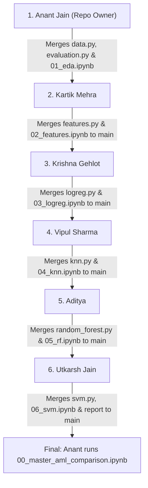

# Image-Tagging: Automatic Clothing Category Recognition

**Title:** Inventory Image Tagging via Handcrafted Features and a Small CNN  
**Course Project:** Project 11 | Team T112 | Section D (6 Members)  
**Dataset:** [Fashion-MNIST (Official Zalando Dataset)](https://github.com/zalandoresearch/fashion-mnist)  
**Repository:** [`anantjain-afk/Image-Tagging`](https://github.com/anantjain-afk/Image-Tagging) (Owner & Sole PR Merger: **Anant Jain**)  
**Current Milestone:** **Phase 1 (Applied Machine Learning Baseline)**

---

## 1. Project Overview & The "Hybrid" Logic

Can fixed, handcrafted visual descriptors adequately classify clothing for a commercial inventory catalogue, or does fine-grained category confusion necessitate hierarchical visual representations learned by a Convolutional Neural Network (CNN)?

To rigorously evaluate this question, our project is structured into two phases:
1. **Phase 1 (Current): Applied Machine Learning (AML) Baseline**
   - Normalize $28 \times 28$ grayscale apparel images into $[0.0, 1.0]$.
   - Compare two distinct visual input representations:
     - **Flattened Raw Pixels** ($784$ dimensions)
     - **Histogram of Oriented Gradients (HOG)** ($324$ dimensions: $9$ orientations, $7\times 7$ cells, $2\times 2$ blocks, L2-Hys normalization)
   - Train and benchmark four classification algorithms:
     1. **Logistic Regression** (Linear baseline)
     2. **$k$-Nearest Neighbors ($k$-NN)** (Instance-based baseline)
     3. **Random Forest** (Non-linear tree ensemble)
     4. **Support Vector Machine (SVM)** (Maximum margin baseline)
   - Benchmark all **8 combinations** on accuracy, macro F1, per-class recall, parameter count, and inference latency.
   - **Identify "The Gap":** Conduct a deep-dive error analysis on visually ambiguous garments (**T-shirt/top, Shirt, Pullover, Coat**), exposing why fixed descriptors struggle with fine-grained neckline/sleeve/button geometry.
2. **Phase 2 (Future Milestone): Deep Learning (CNN) Model**
   - Train a 2-to-3 block CNN with convolutional layers, pooling, dropout, and early stopping.
   - Compare CNN confusion matrices directly against Phase 1 AML baselines to verify whether learned hierarchical features resolve the category confusion gap.

---

## 2. Team Workflow & Sequential Order of Execution (1 to 6)

To guarantee **zero merge conflicts** and maintain a clean git history, the team completes the implementation in a strict sequential order.

> [!IMPORTANT]
> **Repository Ownership & Merge Policy:**  
> **Anant Jain ([`anantjain-afk`](https://github.com/anantjain-afk)) is the repository owner and the ONLY member authorized to merge Pull Requests into `main`.**  
> Each member creates a feature branch, completes their assigned task, tests it, opens a Pull Request to `main`, and notifies Anant to review and merge.



### Execution Steps:
1. **Step 1: Anant Jain (1)** — Establishes repo structure, `requirements.txt`, `src/aml/data.py` (Fashion-MNIST loader & 48k/12k train/val split), `src/aml/evaluation.py`, and completes full Exploratory Data Analysis in `notebooks/01_exploratory_data_analysis.ipynb`. Merges to `main`.
2. **Step 2: Kartik Mehra (2)** — Pulls `main`, implements `src/aml/features.py` (Pixels + HOG), creates precomputed feature cache in `data/cache/`, and completes `notebooks/02_feature_exploration.ipynb`. Anant merges Kartik's PR.
3. **Step 3: Krishna Gehlot (3)** — Pulls `main`, implements Model 1: Logistic Regression in `src/aml/models/logreg.py`, generates weight coefficient heatmaps in `notebooks/03_logistic_regression.ipynb`, and exports JSON metrics. Anant merges Krishna's PR.
4. **Step 4: Vipul Sharma (4)** — Pulls `main`, implements Model 2: $k$-NN in `src/aml/models/knn.py`, conducts an in-depth latency and memory scaling analysis in `notebooks/04_knn_experiments.ipynb`, and exports JSON metrics. Anant merges Vipul's PR.
5. **Step 5: Aditya (5)** — Pulls `main`, implements Model 3: Random Forest in `src/aml/models/random_forest.py`, analyzes overfitting and Gini feature importances in `notebooks/05_random_forest.ipynb`, and exports JSON metrics. Anant merges Aditya's PR.
6. **Step 6: Utkarsh Jain (6)** — Pulls `main`, implements Model 4: Linear SVM in `src/aml/models/svm.py` and `src/aml/error_analysis.py`. Performs cross-model garment confusion analysis across all 4 models, generates misclassification galleries in `notebooks/06_svm_and_error_analysis.ipynb`, and writes `reports/error_analysis.md` outlining "The Gap". Anant merges Utkarsh's PR.
7. **Final Wrap-Up: Anant Jain** — Pulls `main` (now containing all 8 JSON results) and runs `notebooks/00_master_aml_comparison.ipynb` to render the final benchmark comparison table and charts.

---

## 3. Team Member Assignments & Guides

| Order | Member | GitHub | Phase 1 Ownership | Key Owned Files | Individual Guide |
|---|---|---|---|---|---|
| **1st** | **Anant Jain** | [`anantjain-afk`](https://github.com/anantjain-afk) | **Repository Setup, Data Pipeline, EDA & Master Notebook** | `src/aml/data.py`<br>`src/aml/evaluation.py`<br>`notebooks/01_exploratory_data_analysis.ipynb`<br>`notebooks/00_master_aml_comparison.ipynb`<br>`reports/figures/eda/` | [01_Anant_Setup_Data_MasterNotebook.md](docs/team/01_Anant_Setup_Data_MasterNotebook.md) |
| **2nd** | **Kartik Mehra** | [`KartikMehra22`](https://github.com/KartikMehra22) | **Feature Extraction (Pixels & HOG), Caching & Exploration** | `src/aml/features.py`<br>`notebooks/02_feature_exploration.ipynb`<br>`data/cache/` utility<br>`reports/figures/features/` | [02_Kartik_Feature_Extraction_HOG.md](docs/team/02_Kartik_Feature_Extraction_HOG.md) |
| **3rd** | **Krishna Gehlot** | [`NSTKrishna`](https://github.com/NSTKrishna) | **Model 1: Logistic Regression & Weight Heatmaps** | `src/aml/models/logreg.py`<br>`notebooks/03_logistic_regression.ipynb`<br>`reports/results/logreg_*.json`<br>`reports/figures/logreg/` | [03_Krishna_Logistic_Regression.md](docs/team/03_Krishna_Logistic_Regression.md) |
| **4th** | **Vipul Sharma** | [`vs-code06`](https://github.com/vs-code06) | **Model 2: $k$-Nearest Neighbors ($k$-NN) & Latency Profiling** | `src/aml/models/knn.py`<br>`notebooks/04_knn_experiments.ipynb`<br>`reports/results/knn_*.json`<br>`reports/figures/knn/` | [04_Vipul_KNN_Classifier.md](docs/team/04_Vipul_KNN_Classifier.md) |
| **5th** | **Aditya** | [`AdityaInnovates`](https://github.com/AdityaInnovates) | **Model 3: Random Forest & Overfitting / Feature Importance** | `src/aml/models/random_forest.py`<br>`notebooks/05_random_forest.ipynb`<br>`reports/results/rf_*.json`<br>`reports/figures/rf/` | [05_Aditya_Random_Forest.md](docs/team/05_Aditya_Random_Forest.md) |
| **6th** | **Utkarsh Jain** | [`UJ474`](https://github.com/UJ474) | **Model 4: Support Vector Machine (SVM) & Garment Error Analysis** | `src/aml/models/svm.py`<br>`src/aml/error_analysis.py`<br>`notebooks/06_svm_and_error_analysis.ipynb`<br>`reports/error_analysis.md`<br>`reports/figures/errors/` | [06_Utkarsh_SVM_Error_Analysis.md](docs/team/06_Utkarsh_SVM_Error_Analysis.md) |

For comprehensive technical rules and coordination details, see [**`docs/team/README.md`**](docs/team/README.md).

---

## 4. Shared Technical Standards

- **Dataset:** Official Fashion-MNIST (Zalando Research). Grayscale images of size $28 \times 28$.
- **Class Labels (10):**
  - `0`: T-shirt/top | `1`: Trouser | `2`: Pullover | `3`: Dress | `4`: Coat
  - `5`: Sandal | `6`: Shirt | `7`: Sneaker | `8`: Bag | `9`: Ankle boot
- **Split Scheme:**
  - Official Train Set: 60,000 images.
  - Development Split: **48,000 Training** and **12,000 Validation** (Stratified, `random_state=42`).
  - Official Test Set: **10,000 images** (Held-out; only evaluated once for final reporting).
- **Pixel Normalization:** Divide raw $[0, 255]$ uint8 values by $255.0$ to obtain `float32` in $[0.0, 1.0]$.
- **Features:**
  - `pixels`: Flattened 1D vector of shape `(N, 784)`.
  - `hog`: 9 orientations, $7\times 7$ pixels per cell, $2\times 2$ cells per block, L2-Hys normalization. Output shape: `(N, 324)`.
- **Metrics Evaluated:** Accuracy, Macro F1, Per-class Recall, Parameter Count / Complexity, Inference Latency (ms/image).

---

## 5. Repository Structure

```
Image-Tagging/
├── README.md                                  # Repository landing page
├── prompt.md                                  # Prompt template for AI-assisted dev
├── requirements.txt                           # Core dependencies
├── pyproject.toml                             # Package configuration
├── docs/team/                                 # Individual teammate guides (Markdown)
│   ├── README.md                              # Master team guide & technical agreement
│   ├── 01_Anant_Setup_Data_MasterNotebook.md
│   ├── 02_Kartik_Feature_Extraction_HOG.md
│   ├── 03_Krishna_Logistic_Regression.md
│   ├── 04_Vipul_KNN_Classifier.md
│   ├── 05_Aditya_Random_Forest.md
│   └── 06_Utkarsh_SVM_Error_Analysis.md
├── src/aml/                                   # Source package
│   ├── __init__.py
│   ├── data.py                                # Fashion-MNIST loader & 48k/12k split
│   ├── features.py                            # Pixels (784) & HOG (324) extraction
│   ├── evaluation.py                          # Metric calculation & latency timer
│   ├── error_analysis.py                      # Confusion matrices & error galleries
│   └── models/
│       ├── __init__.py
│       ├── logreg.py                          # Logistic Regression
│       ├── knn.py                             # k-Nearest Neighbors
│       ├── random_forest.py                   # Random Forest
│       └── svm.py                             # Support Vector Machine
├── notebooks/                                 # Individual & Master Jupyter Notebooks
│   ├── 00_master_aml_comparison.ipynb        # Master benchmark comparison & synthesis
│   ├── 01_exploratory_data_analysis.ipynb     # Exploratory Data Analysis (EDA)
│   ├── 02_feature_exploration.ipynb           # Pixels vs. HOG feature visual analysis
│   ├── 03_logistic_regression.ipynb           # Model 1: Logistic Regression experiments
│   ├── 04_knn_experiments.ipynb               # Model 2: k-NN & latency scaling
│   ├── 05_random_forest.ipynb                 # Model 3: Random Forest & feature importance
│   └── 06_svm_and_error_analysis.ipynb        # Model 4: Linear SVM & error galleries
└── reports/
    ├── error_analysis.md                      # The Gap: Detailed error analysis
    ├── figures/                               # Exported charts & visualizations
    │   ├── eda/                               # Class balance, intensity, archetypes, PCA
    │   ├── features/                          # HOG vs. pixels, upper-body comparisons
    │   ├── logreg/                            # Weight heatmaps, recall charts
    │   ├── knn/                               # Latency scaling, tuning curves
    │   ├── rf/                                # Overfitting curves, feature importances
    │   └── errors/                            # Confusion matrices & misclassifications
    └── results/                               # 8 standardized JSON result files
```

---

## 6. Getting Started

```bash
# Clone the repository
git clone https://github.com/anantjain-afk/Image-Tagging.git
cd Image-Tagging

# Create and activate Python virtual environment
python3 -m venv .venv
source .venv/bin/activate  # On Windows PowerShell: .\.venv\Scripts\Activate.ps1

# Install dependencies in editable mode
pip install -r requirements.txt
pip install -e . --no-deps
```

### Verify the shared data pipeline

Run from the repository root after activating `.venv`:

```bash
python -c "from aml.data import get_train_val_test_splits; d = get_train_val_test_splits(); print('X_train:', d['X_train'].shape, 'X_val:', d['X_val'].shape, 'X_test:', d['X_test'].shape)"
```

Expected: `X_train: (48000, 28, 28) X_val: (12000, 28, 28) X_test: (10000, 28, 28)`.
The first call downloads the official IDX files from
[Zalando's Fashion-MNIST repository](https://github.com/zalandoresearch/fashion-mnist)
and verifies the published checksums. Later calls use
`data/raw/fashion_mnist_raw.npz` offline. Images are `float32` in `[0, 1]`;
labels are `int64`. Keep the official test set held out during model selection.
Refit the selected configuration on `X_train_full`/`y_train_full` before final testing.

Run the offline foundation checks without downloading the dataset:

```bash
python -m unittest discover -s tests -v
```

### Shared evaluation helpers

```python
from aml.evaluation import compute_metrics, count_parameters, measure_inference_latency

metrics = compute_metrics(y_test, model.predict(X_test_features))
latency_ms = measure_inference_latency(model, X_test_features[:1000])
```

`compute_metrics` returns JSON-ready accuracy, macro F1, ten per-class recalls,
and a 10-by-10 confusion matrix in the class order above. Macro F1 always averages
all ten classes; undefined scores are zero. `count_parameters(model)` counts
linear coefficients plus intercepts, or total random-forest nodes, and accepts
fitted pipelines. For k-NN, report stored feature memory in **MiB**
(`X_train_full_features.nbytes / 1024**2`), matching the k-NN guide's calculation.
The legacy JSON field `parameter_count` therefore means weights for linear models,
nodes for forests, and MiB for k-NN; these quantities are not directly comparable.

Latency is the median of five warmed-up `predict` calls, divided by the batch size.
Use the same hardware and 1,000-image batches for comparisons. Pipeline preprocessing
is included; separately computed Pixels/HOG extraction is excluded.

### Master comparison notebook

```bash
jupyter lab notebooks/00_master_aml_comparison.ipynb
```

Run all cells from either the repository root or `notebooks/`. The notebook checks
the eight expected JSON files in `reports/results/`, displays missing contributions,
and renders the final table, grouped charts, and findings when all eight are valid.
It reads reported results only; it does not train models or reevaluate the test set.
Final synthesis remains pending until the model owners provide their results.
