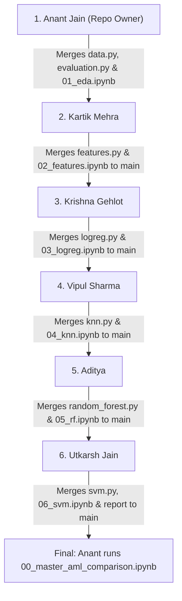

# Image-Tagging: Automatic Clothing Category Recognition

**Title:** Inventory Image Tagging via Handcrafted Features and a Small CNN  
**Course Project:** Project 11 | Team T112 | Section D (6 Members)  
**Dataset:** [Fashion-MNIST (Official Zalando Dataset)](https://github.com/zalandoresearch/fashion-mnist)  
**Repository:** [`anantjain-afk/Image-Tagging`](https://github.com/anantjain-afk/Image-Tagging) (Owner & Sole PR Merger: **Anant Jain**)  
**Current Milestone:** **Phase 1 (Applied Machine Learning Baseline)**

---

## 1. Project Overview & The "Hybrid" Logic

Can fixed, handcrafted visual descriptors adequately classify clothing for a commercial inventory catalogue, or does fine-grained category confusion necessitate hierarchical visual representations learned by a Convolutional Neural Network (CNN)?

To rigorously evaluate this question, our project is structured into two phases:
1. **Phase 1 (Current): Applied Machine Learning (AML) Baseline**
   - Normalize $28 \times 28$ grayscale apparel images into $[0.0, 1.0]$.
   - Compare two distinct visual input representations:
     - **Flattened Raw Pixels** ($784$ dimensions)
     - **Histogram of Oriented Gradients (HOG)** ($324$ dimensions: $9$ orientations, $7\times 7$ cells, $2\times 2$ blocks, L2-Hys normalization)
   - Train and benchmark four classification algorithms:
     1. **Logistic Regression** (Linear baseline)
     2. **$k$-Nearest Neighbors ($k$-NN)** (Instance-based baseline)
     3. **Random Forest** (Non-linear tree ensemble)
     4. **Support Vector Machine (SVM)** (Maximum margin baseline)
   - Benchmark all **8 combinations** on accuracy, macro F1, per-class recall, parameter count, and inference latency.
   - **Identify "The Gap":** Conduct a deep-dive error analysis on visually ambiguous garments (**T-shirt/top, Shirt, Pullover, Coat**), exposing why fixed descriptors struggle with fine-grained neckline/sleeve/button geometry.
2. **Phase 2 (Future Milestone): Deep Learning (CNN) Model**
   - Train a 2-to-3 block CNN with convolutional layers, pooling, dropout, and early stopping.
   - Compare CNN confusion matrices directly against Phase 1 AML baselines to verify whether learned hierarchical features resolve the category confusion gap.

---

## 2. Team Workflow & Sequential Order of Execution (1 to 6)

To guarantee **zero merge conflicts** and maintain a clean git history, the team completes the implementation in a strict sequential order.

> [!IMPORTANT]
> **Repository Ownership & Merge Policy:**  
> **Anant Jain ([`anantjain-afk`](https://github.com/anantjain-afk)) is the repository owner and the ONLY member authorized to merge Pull Requests into `main`.**  
> Each member creates a feature branch, completes their assigned task, tests it, opens a Pull Request to `main`, and notifies Anant to review and merge.



### Execution Steps:
1. **Step 1: Anant Jain (1)** — Establishes repo structure, `requirements.txt`, `src/aml/data.py` (Fashion-MNIST loader & 48k/12k train/val split), `src/aml/evaluation.py`, and completes full Exploratory Data Analysis in `notebooks/01_exploratory_data_analysis.ipynb`. Merges to `main`.
2. **Step 2: Kartik Mehra (2)** — Pulls `main`, implements `src/aml/features.py` (Pixels + HOG), creates precomputed feature cache in `data/cache/`, and completes `notebooks/02_feature_exploration.ipynb`. Anant merges Kartik's PR.
3. **Step 3: Krishna Gehlot (3)** — Pulls `main`, implements Model 1: Logistic Regression in `src/aml/models/logreg.py`, generates weight coefficient heatmaps in `notebooks/03_logistic_regression.ipynb`, and exports JSON metrics. Anant merges Krishna's PR.
4. **Step 4: Vipul Sharma (4)** — Pulls `main`, implements Model 2: $k$-NN in `src/aml/models/knn.py`, conducts an in-depth latency and memory scaling analysis in `notebooks/04_knn_experiments.ipynb`, and exports JSON metrics. Anant merges Vipul's PR.
5. **Step 5: Aditya (5)** — Pulls `main`, implements Model 3: Random Forest in `src/aml/models/random_forest.py`, analyzes overfitting and Gini feature importances in `notebooks/05_random_forest.ipynb`, and exports JSON metrics. Anant merges Aditya's PR.
6. **Step 6: Utkarsh Jain (6)** — Pulls `main`, implements Model 4: Linear SVM in `src/aml/models/svm.py` and `src/aml/error_analysis.py`. Performs cross-model garment confusion analysis across all 4 models, generates misclassification galleries in `notebooks/06_svm_and_error_analysis.ipynb`, and writes `reports/error_analysis.md` outlining "The Gap". Anant merges Utkarsh's PR.
7. **Final Wrap-Up: Anant Jain** — Pulls `main` (now containing all 8 JSON results) and runs `notebooks/00_master_aml_comparison.ipynb` to render the final benchmark comparison table and charts.

---

## 3. Team Member Work Breakdown & Detailed Contributions

To ensure academic accountability and technical clarity, every component of this project was individually owned, implemented, and documented by a dedicated team member. Below is the comprehensive breakdown of who did what work:

| Order | Member | GitHub Handle | Phase 1 Role & Ownership | Key Owned Files | Individual Guide |
|---|---|---|---|---|---|
| **1st** | **Anant Jain** | [`anantjain-afk`](https://github.com/anantjain-afk) | **Repository Scaffolding, Data Pipeline, EDA & Master Benchmark Integration** | `src/aml/data.py`<br>`src/aml/evaluation.py`<br>`notebooks/01_exploratory_data_analysis.ipynb`<br>`notebooks/00_master_aml_comparison.ipynb`<br>`reports/figures/eda/` | [01_Anant_Setup_Data_MasterNotebook.md](docs/team/01_Anant_Setup_Data_MasterNotebook.md) |
| **2nd** | **Kartik Mehra** | [`KartikMehra22`](https://github.com/KartikMehra22) | **Feature Engineering (Pixels & HOG), Caching Utility & Exploration** | `src/aml/features.py`<br>`notebooks/02_feature_exploration.ipynb`<br>`data/cache/` utility<br>`reports/figures/features/` | [02_Kartik_Feature_Extraction_HOG.md](docs/team/02_Kartik_Feature_Extraction_HOG.md) |
| **3rd** | **Krishna Gehlot** | [`NSTKrishna`](https://github.com/NSTKrishna) | **Model 1: Logistic Regression Pipeline & Weight Coefficient Heatmaps** | `src/aml/models/logreg.py`<br>`notebooks/03_logistic_regression.ipynb`<br>`reports/results/logreg_*.json`<br>`reports/figures/logreg/` | [03_Krishna_Logistic_Regression.md](docs/team/03_Krishna_Logistic_Regression.md) |
| **4th** | **Vipul Sharma** | [`vs-code06`](https://github.com/vs-code06) | **Model 2: $k$-Nearest Neighbors ($k$-NN) & Latency/Memory Scaling Analysis** | `src/aml/models/knn.py`<br>`notebooks/04_knn_experiments.ipynb`<br>`reports/results/knn_*.json`<br>`reports/figures/knn/` | [04_Vipul_KNN_Classifier.md](docs/team/04_Vipul_KNN_Classifier.md) |
| **5th** | **Aditya** | [`AdityaInnovates`](https://github.com/AdityaInnovates) | **Model 3: Random Forest Ensemble, Overfitting & Feature Importance** | `src/aml/models/random_forest.py`<br>`notebooks/05_random_forest.ipynb`<br>`reports/results/rf_*.json`<br>`reports/figures/rf/` | [05_Aditya_Random_Forest.md](docs/team/05_Aditya_Random_Forest.md) |
| **6th** | **Utkarsh Jain** | [`UJ474`](https://github.com/UJ474) | **Model 4: Support Vector Machine (Linear SVM) & Garment Error Analysis** | `src/aml/models/svm.py`<br>`src/aml/error_analysis.py`<br>`notebooks/06_svm_and_error_analysis.ipynb`<br>`reports/error_analysis.md`<br>`reports/figures/errors/` | [06_Utkarsh_SVM_Error_Analysis.md](docs/team/06_Utkarsh_SVM_Error_Analysis.md) |

---

### Detailed Member Contributions & Deliverables

#### 1. Anant Jain ([`anantjain-afk`](https://github.com/anantjain-afk)) — Repository Setup, Data Pipeline, EDA & Master Synthesis
- **Role:** Project Lead, Repository Owner, Milestone 1 & Milestone 4 Lead.
- **Merge Authority:** Sole authorized member responsible for reviewing and merging all teammate Pull Requests into `main`.
- **Core Engineering & Deliverables:**
  - **Repository Architecture:** Established project structure, `.gitignore`, dependency specifications in `requirements.txt`, and package configuration in `pyproject.toml`.
  - **Shared Data Pipeline ([`src/aml/data.py`](src/aml/data.py)):** Built checksum-verified automated downloader for official Fashion-MNIST IDX binaries; implemented `float32` normalization into $[0.0, 1.0]$; constructed stratified 48,000 / 12,000 train/validation splits (`random_state=42`) and held out the official 10,000-image test set; added atomic compressed `.npz` caching.
  - **Evaluation Standards ([`src/aml/evaluation.py`](src/aml/evaluation.py)):** Implemented team-wide `compute_metrics()` (accuracy, macro F1, 10 per-class recalls, and $10 \times 10$ confusion matrix), `count_parameters()` for linear models and tree ensembles, and `measure_inference_latency()` with warmed-up median batch timing.
  - **Exploratory Data Analysis ([`notebooks/01_exploratory_data_analysis.ipynb`](notebooks/01_exploratory_data_analysis.ipynb)):** Conducted rigorous dataset audit verifying exact 6,000/1,000 image class balance; analyzed pixel intensity distributions; generated mean archetype and pixel-wise variance heatmaps; built a 25-image variety grid; executed unsupervised 2D PCA projection demonstrating the topological entanglement of upper-body tops in pixel space.
  - **Master Comparison Notebook ([`notebooks/00_master_aml_comparison.ipynb`](notebooks/00_master_aml_comparison.ipynb)):** Final integration deliverable that validates all 8 JSON records in `reports/results/`, compiles the comprehensive cross-model benchmark table, renders accuracy/F1 bar charts, and synthesizes overall Phase 1 conclusions.
  - **Unit Test Suite ([`tests/`](tests/)):** Wrote 35 unit tests validating data loading, feature shapes, metric invariants, and model export schemas.
  - **Exported Figures:** [`reports/figures/eda/`](reports/figures/eda/) (`class_balance.png`, `pixel_intensity_distribution.png`, `class_mean_and_variance.png`, `variety_grid.png`, `pca_2d_projection.png`).

#### 2. Kartik Mehra ([`KartikMehra22`](https://github.com/KartikMehra22)) — Feature Extraction, HOG Engine & Feature Exploration
- **Role:** Feature Pipeline Engineer, Milestone 2 Lead.
- **Core Engineering & Deliverables:**
  - **Feature Extraction Engine ([`src/aml/features.py`](src/aml/features.py)):**
    - Raw Pixels: Flattened $(N, 28, 28)$ images into $(N, 784)$ float32 vectors.
    - Histogram of Oriented Gradients (HOG): Implemented scikit-image HOG extraction with 9 orientation bins, $7 \times 7$ pixels per cell, and $2 \times 2$ cells per block (L2-Hys block normalization), yielding compact 324-dimensional feature vectors.
    - Caching Utility: Built `get_features()` with offline `.npz` storage and the `precompute_and_cache_all()` CLI script to eliminate redundant feature extraction across teammates.
  - **Feature Exploration ([`notebooks/02_feature_exploration.ipynb`](notebooks/02_feature_exploration.ipynb)):**
    - Visualized HOG gradient arrow overlays across all 10 garment categories.
    - Investigated upper-body silhouette ambiguity, illustrating why $7 \times 7$ cell pooling smooths away fine spatial cues (collar tips, buttons, seams).
    - Produced polar orientation profiles demonstrating sharp directional peaks for structured items (trousers at 90°, shoes at 0°/180°) vs. isotropic diffuse energy for shirts and tops.
    - Added automated assertions validating feature shapes and non-negativity.
  - **Exported Figures:** [`reports/figures/features/`](reports/figures/features/) (`hog_class_examples.png`, `upper_body_hog_comparison.png`, `hog_orientation_profiles.png`).

#### 3. Krishna Gehlot ([`NSTKrishna`](https://github.com/NSTKrishna)) — Model 1: Logistic Regression & Weight Heatmaps
- **Role:** Linear Baseline Modeling Engineer, Milestone 3.
- **Core Engineering & Deliverables:**
  - **Model Architecture & Tuning ([`src/aml/models/logreg.py`](src/aml/models/logreg.py)):**
    - Constructed `StandardScaler` + multinomial `LogisticRegression` pipeline using L-BFGS solver with `max_iter=2000` to guarantee complete convergence.
    - Built hyperparameter tuning grid across inverse regularization strength $C \in \{0.1, 1.0, 10.0\}$ selecting best model by validation Macro F1.
    - Standardized evaluation functions for refitting on all 60,000 training images and testing on the held-out test set.
  - **Experimentation & Interpretability ([`notebooks/03_logistic_regression.ipynb`](notebooks/03_logistic_regression.ipynb)):**
    - Evaluated Raw Pixels ($C=1.0$: Val F1 85.34%, Test Accuracy 84.32%, Macro F1 84.24%) and HOG ($C=1.0$: Val F1 85.16%, Test Accuracy 84.55%, Macro F1 84.49%).
    - Unpacked linear decision boundaries by reshaping learned multiclass weight coefficients back into $28 \times 28$ spatial heatmaps for all 10 classes, revealing positive weights on silhouettes and negative weights on conflicting boundaries (e.g., negative collar zone for crewneck T-shirts).
  - **Exported Deliverables:** [`reports/results/logreg_pixels.json`](reports/results/logreg_pixels.json), [`reports/results/logreg_hog.json`](reports/results/logreg_hog.json), and [`reports/figures/logreg/`](reports/figures/logreg/) (`pixel_weight_heatmaps.png`, `per_class_recall.png`).

#### 4. Vipul Sharma ([`vs-code06`](https://github.com/vs-code06)) — Model 2: $k$-Nearest Neighbors & Latency/Memory Scaling Analysis
- **Role:** Non-Parametric Modeling Engineer, Milestone 3.
- **Core Engineering & Deliverables:**
  - **Model Architecture & Batching ([`src/aml/models/knn.py`](src/aml/models/knn.py)):**
    - Built `KNeighborsClassifier` pipeline with Euclidean distance and brute-force search.
    - Implemented chunked matrix inference (`predict_in_batches`, batch size 500) preventing RAM exhaustion during distance calculation across 48k/60k images.
    - Grid-searched neighborhood size $k \in \{3, 5, 7, 9\}$ and distance-inverse weighting (`uniform` vs. `distance`).
  - **Computational Scaling & Latency Study ([`notebooks/04_knn_experiments.ipynb`](notebooks/04_knn_experiments.ipynb)):**
    - Evaluated Raw Pixels ($k=5$, distance: Val F1 85.67%, Test Accuracy 85.41%, Macro F1 85.40%) and HOG ($k=9$, distance: Val F1 84.75%, Test Accuracy 83.84%, Macro F1 83.85%).
    - Conducted comprehensive latency and throughput profiling, demonstrating that dimensionality reduction via HOG yields a **64.2% reduction in prediction latency** (0.098 ms vs. 0.274 ms/image).
    - Quantified non-parametric memory footprint: Storing 60,000 raw training vectors requires **179.44 MiB** vs. **74.16 MiB** for HOG (58.7% memory savings).
    - Analyzed production trade-offs and viability for real-time inventory catalog tagging.
  - **Exported Deliverables:** [`reports/results/knn_pixels.json`](reports/results/knn_pixels.json), [`reports/results/knn_hog.json`](reports/results/knn_hog.json), and [`reports/figures/knn/`](reports/figures/knn/) (`knn_tuning_comparison.png`, `latency_comparison.png`, `per_class_recall.png`, `confusion_matrix.png`).

#### 5. Aditya ([`AdityaInnovates`](https://github.com/AdityaInnovates)) — Model 3: Random Forest Classifier, Overfitting & Feature Importance
- **Role:** Tree Ensemble Modeling Engineer, Milestone 3.
- **Core Engineering & Deliverables:**
  - **Model Architecture ([`src/aml/models/random_forest.py`](src/aml/models/random_forest.py)):**
    - Implemented multi-threaded `RandomForestClassifier` with `n_jobs=-1` and reproducible seed control.
    - Implemented 2D grid search across `n_estimators` $\in \{50, 100, 200\}$ and `max_depth` $\in \{10, 20, \text{None}\}$.
    - Formulated dual-split scoring (training and validation) to explicitly track generalization error and tree growth dynamics.
  - **Overfitting & Feature Importance Analysis ([`notebooks/05_random_forest.ipynb`](notebooks/05_random_forest.ipynb)):**
    - Achieved Phase 1's highest overall test accuracy: Raw Pixels (200 trees, depth 20: Val F1 88.45%, **Test Accuracy 87.43%**, **Test Macro F1 87.31%**) and HOG (200 trees, unconstrained depth: Val F1 84.91%, Test Accuracy 84.35%, Test Macro F1 84.30%).
    - Proved that unconstrained depth (`max_depth=None`) causes complete training split memorization (100% training accuracy with 1.7M–2.5M nodes) while validation F1 plateaus, proving `max_depth=20` as an optimal regularizer.
    - Analyzed Gini feature importance: mapped pixel importances back to $28 \times 28$ image space to reveal decision boundaries focused on silhouette borders, shoulder slopes, and hems.
  - **Exported Deliverables:** [`reports/results/rf_pixels.json`](reports/results/rf_pixels.json), [`reports/results/rf_hog.json`](reports/results/rf_hog.json), and [`reports/figures/rf/`](reports/figures/rf/) (`overfitting_curves.png`, `pixel_importance_heatmap.png`, `hog_importance.png`).

#### 6. Utkarsh Jain ([`UJ474`](https://github.com/UJ474)) — Model 4: Support Vector Machine (Linear SVM) & Garment Error Analysis
- **Role:** Maximum Margin Modeling Engineer, Lead Error Analyst, Milestone 3 & Milestone 4.
- **Core Engineering & Deliverables:**
  - **Linear SVM Pipeline ([`src/aml/models/svm.py`](src/aml/models/svm.py)):**
    - Implemented `StandardScaler(with_mean=False)` + `LinearSVC` with automatic dual solver selection (`dual='auto'`).
    - Grid-searched penalty parameter $C \in \{0.1, 1.0, 10.0\}$ selecting best candidate by validation Macro F1.
    - Validated fastest inference across all models: **0.0006–0.0013 ms/image** (over 200x faster than $k$-NN).
  - **Error Analysis Toolkit ([`src/aml/error_analysis.py`](src/aml/error_analysis.py)):**
    - Implemented full-row normalized confusion matrix visualization.
    - Implemented focused upper-body submatrices (classes 0, 2, 4, 6) preserving overall prediction distribution.
    - Built misclassification gallery extractors for paired error analysis.
  - **Experimentation ([`notebooks/06_svm_and_error_analysis.ipynb`](notebooks/06_svm_and_error_analysis.ipynb)):**
    - Evaluated Raw Pixels ($C=0.1$: Val F1 85.57%, Test Accuracy 83.80%, Macro F1 83.57%) and HOG ($C=0.1$: Val F1 85.06%, Test Accuracy 84.23%, Macro F1 84.06%).
    - Generated visual misclassification galleries identifying where collars and textures are lost at $28 \times 28$ resolution.
  - **Academic Synthesis Report ([`reports/error_analysis.md`](reports/error_analysis.md)):**
    - Authored the core Phase 1 synthesis report documenting "The Gap": the ~35% recall deficit for Shirt and 32%–41% upper-body directional confusion across all 4 model families.
    - Articulated the mathematical limits of linear hyperplanes, axis-aligned splits, and Euclidean distance on flattened pixels and fixed HOG bins.
    - Formulated the inductive biases and auditable success criteria for the Phase 2 Small CNN.
  - **Exported Deliverables:** [`reports/results/svm_pixels.json`](reports/results/svm_pixels.json), [`reports/results/svm_hog.json`](reports/results/svm_hog.json), and [`reports/figures/errors/`](reports/figures/errors/) (`svm_pixels_confusion_matrix.png`, `svm_pixels_upper_body_confusion.png`, `svm_pixels_6_as_0_gallery.png`, `svm_pixels_2_as_4_gallery.png`).

---

For comprehensive technical rules, team coordination protocols, and branch policies, see [**`docs/team/README.md`**](docs/team/README.md).

---

## 4. Shared Technical Standards

- **Dataset:** Official Fashion-MNIST (Zalando Research). Grayscale images of size $28 \times 28$.
- **Class Labels (10):**
  - `0`: T-shirt/top | `1`: Trouser | `2`: Pullover | `3`: Dress | `4`: Coat
  - `5`: Sandal | `6`: Shirt | `7`: Sneaker | `8`: Bag | `9`: Ankle boot
- **Split Scheme:**
  - Official Train Set: 60,000 images.
  - Development Split: **48,000 Training** and **12,000 Validation** (Stratified, `random_state=42`).
  - Official Test Set: **10,000 images** (Held-out; only evaluated once for final reporting).
- **Pixel Normalization:** Divide raw $[0, 255]$ uint8 values by $255.0$ to obtain `float32` in $[0.0, 1.0]$.
- **Features:**
  - `pixels`: Flattened 1D vector of shape `(N, 784)`.
  - `hog`: 9 orientations, $7\times 7$ pixels per cell, $2\times 2$ cells per block, L2-Hys normalization. Output shape: `(N, 324)`.
- **Metrics Evaluated:** Accuracy, Macro F1, Per-class Recall, Parameter Count / Complexity, Inference Latency (ms/image).

---

## 5. Repository Structure

```
Image-Tagging/
├── README.md                                  # Repository landing page
├── prompt.md                                  # Prompt template for AI-assisted dev
├── requirements.txt                           # Core dependencies
├── pyproject.toml                             # Package configuration
├── docs/team/                                 # Individual teammate guides (Markdown)
│   ├── README.md                              # Master team guide & technical agreement
│   ├── 01_Anant_Setup_Data_MasterNotebook.md
│   ├── 02_Kartik_Feature_Extraction_HOG.md
│   ├── 03_Krishna_Logistic_Regression.md
│   ├── 04_Vipul_KNN_Classifier.md
│   ├── 05_Aditya_Random_Forest.md
│   └── 06_Utkarsh_SVM_Error_Analysis.md
├── src/aml/                                   # Source package
│   ├── __init__.py
│   ├── data.py                                # Fashion-MNIST loader & 48k/12k split
│   ├── features.py                            # Pixels (784) & HOG (324) extraction
│   ├── evaluation.py                          # Metric calculation & latency timer
│   ├── error_analysis.py                      # Confusion matrices & error galleries
│   └── models/
│       ├── __init__.py
│       ├── logreg.py                          # Logistic Regression
│       ├── knn.py                             # k-Nearest Neighbors
│       ├── random_forest.py                   # Random Forest
│       └── svm.py                             # Support Vector Machine
├── notebooks/                                 # Individual & Master Jupyter Notebooks
│   ├── 00_master_aml_comparison.ipynb        # Master benchmark comparison & synthesis
│   ├── 01_exploratory_data_analysis.ipynb     # Exploratory Data Analysis (EDA)
│   ├── 02_feature_exploration.ipynb           # Pixels vs. HOG feature visual analysis
│   ├── 03_logistic_regression.ipynb           # Model 1: Logistic Regression experiments
│   ├── 04_knn_experiments.ipynb               # Model 2: k-NN & latency scaling
│   ├── 05_random_forest.ipynb                 # Model 3: Random Forest & feature importance
│   └── 06_svm_and_error_analysis.ipynb        # Model 4: Linear SVM & error galleries
└── reports/
    ├── error_analysis.md                      # The Gap: Detailed error analysis
    ├── figures/                               # Exported charts & visualizations
    │   ├── eda/                               # Class balance, intensity, archetypes, PCA
    │   ├── features/                          # HOG vs. pixels, upper-body comparisons
    │   ├── logreg/                            # Weight heatmaps, recall charts
    │   ├── knn/                               # Latency scaling, tuning curves
    │   ├── rf/                                # Overfitting curves, feature importances
    │   └── errors/                            # Confusion matrices & misclassifications
    └── results/                               # 8 standardized JSON result files
```

---

## 6. Getting Started

```bash
# Clone the repository
git clone https://github.com/anantjain-afk/Image-Tagging.git
cd Image-Tagging

# Create and activate Python virtual environment
python3 -m venv .venv
source .venv/bin/activate  # On Windows PowerShell: .\.venv\Scripts\Activate.ps1

# Install dependencies in editable mode
pip install -r requirements.txt
pip install -e . --no-deps
```

### Verify the shared data pipeline

Run from the repository root after activating `.venv`:

```bash
python -c "from aml.data import get_train_val_test_splits; d = get_train_val_test_splits(); print('X_train:', d['X_train'].shape, 'X_val:', d['X_val'].shape, 'X_test:', d['X_test'].shape)"
```

Expected: `X_train: (48000, 28, 28) X_val: (12000, 28, 28) X_test: (10000, 28, 28)`.
The first call downloads the official IDX files from
[Zalando's Fashion-MNIST repository](https://github.com/zalandoresearch/fashion-mnist)
and verifies the published checksums. Later calls use
`data/raw/fashion_mnist_raw.npz` offline. Images are `float32` in `[0, 1]`;
labels are `int64`. Keep the official test set held out during model selection.
Refit the selected configuration on `X_train_full`/`y_train_full` before final testing.

Run the offline foundation checks without downloading the dataset:

```bash
python -m unittest discover -s tests -v
```

### Shared evaluation helpers

```python
from aml.evaluation import compute_metrics, count_parameters, measure_inference_latency

metrics = compute_metrics(y_test, model.predict(X_test_features))
latency_ms = measure_inference_latency(model, X_test_features[:1000])
```

`compute_metrics` returns JSON-ready accuracy, macro F1, ten per-class recalls,
and a 10-by-10 confusion matrix in the class order above. Macro F1 always averages
all ten classes; undefined scores are zero. `count_parameters(model)` counts
linear coefficients plus intercepts, or total random-forest nodes, and accepts
fitted pipelines. For k-NN, report stored feature memory in **MiB**
(`X_train_full_features.nbytes / 1024**2`), matching the k-NN guide's calculation.
The legacy JSON field `parameter_count` therefore means weights for linear models,
nodes for forests, and MiB for k-NN; these quantities are not directly comparable.

Latency is the median of five warmed-up `predict` calls, divided by the batch size.
Use the same hardware and 1,000-image batches for comparisons. Pipeline preprocessing
is included; separately computed Pixels/HOG extraction is excluded.

### Master comparison notebook

```bash
jupyter lab notebooks/00_master_aml_comparison.ipynb
```

Run all cells from either the repository root or `notebooks/`. The notebook checks
the eight expected JSON files in `reports/results/`, displays missing contributions,
and renders the final table, grouped charts, and findings when all eight are valid.
It reads reported results only; it does not train models or reevaluate the test set.
Final synthesis remains pending until the model owners provide their results.
