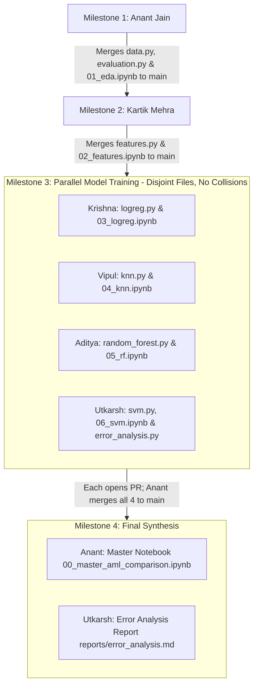

# Project 11: Clothing Category Recognition — Phase 1 Team Master Guide

**Title:** Inventory Image Tagging via Handcrafted Features and a Small CNN  
**Current Phase:** **Phase 1 — Applied Machine Learning (AML) Baseline**  
**Repository:** `anantjain-afk/Image-Tagging` (Owner & Sole PR Merger: **Anant Jain**)  
**Team:** T112 | Section D | 6 Members  

---

## 1. Project Goal & The "Hybrid" Logic

Can fixed, handcrafted visual descriptors adequately classify clothing for a small inventory catalogue, or does visually similar category confusion necessitate hierarchical visual features learned by a Convolutional Neural Network (CNN)?

To answer this, our project is divided into two distinct phases:
- **Phase 1 (Current): AML Baseline:**
  - Normalize $28 \times 28$ Fashion-MNIST images into $[0.0, 1.0]$.
  - Compare two visual representations:
    1. **Flattened Raw Pixels** ($784$ features)
    2. **Histogram of Oriented Gradients (HOG)** ($324$ features)
  - Train and evaluate four distinct classification models:
    1. **Logistic Regression** (Linear baseline)
    2. **$k$-Nearest Neighbors ($k$-NN)** (Instance-based baseline)
    3. **Random Forest** (Non-linear tree ensemble)
    4. **Support Vector Machine (SVM)** (Maximum margin baseline)
  - Benchmark all **8 combinations** on accuracy, macro F1, per-class recall, parameter count, and inference latency.
  - **Identify "The Gap":** Conduct a deep-dive error analysis on ambiguous categories (**T-shirt/top, Shirt, Pullover, Coat**), exposing why fixed descriptors struggle with fine-grained neckline/sleeve/button geometry.
- **Phase 2 (Future): Deep Learning Model:**
  - Train a 2-to-3 block CNN with pooling, dropout, and early stopping to examine whether learned hierarchical representations resolve this classification gap.

---

## 2. Order of Execution & Merge Workflow (Zero Merge Conflicts)

To guarantee **zero merge conflicts** and total clarity, the project follows a clean sequential milestone order. 

> [!IMPORTANT]
> **Repository Owner & Merge Policy:**
> **Anant Jain (`anantjain-afk`) is the repository owner and the ONLY member who merges Pull Requests into `main`.**  
> All other members open a PR from their own feature branch to `main`, tag Anant to review, and Anant merges using a clean merge commit.



### Milestone Schedule:
1. **Milestone 1 (Foundation, Data & EDA):** **Anant** sets up repository structure, dependencies (`requirements.txt`), data loader (`src/aml/data.py`), evaluation helpers (`src/aml/evaluation.py`), and executes the complete exploratory data analysis in `notebooks/01_exploratory_data_analysis.ipynb`. Anant merges to `main`.
2. **Milestone 2 (Feature Pipeline & Caching):** **Kartik** pulls `main`, implements `src/aml/features.py` (Pixels + HOG + disk caching utility), and `notebooks/02_feature_exploration.ipynb`. Kartik opens PR $\rightarrow$ Anant merges to `main`.
3. **Milestone 3 (Parallel Model Development):** **Krishna**, **Vipul**, **Aditya**, and **Utkarsh** pull `main`. Each member works on **strictly isolated, disjoint files**. No two members edit the same file, guaranteeing **zero merge conflicts**:
   - Krishna owns `src/aml/models/logreg.py`, `notebooks/03_logistic_regression.ipynb`, `reports/results/logreg_*.json`
   - Vipul owns `src/aml/models/knn.py`, `notebooks/04_knn_experiments.ipynb`, `reports/results/knn_*.json`
   - Aditya owns `src/aml/models/random_forest.py`, `notebooks/05_random_forest.ipynb`, `reports/results/rf_*.json`
   - Utkarsh owns `src/aml/models/svm.py`, `src/aml/error_analysis.py`, `notebooks/06_svm_and_error_analysis.ipynb`, `reports/results/svm_*.json`
   Each member completes their notebook, exports their 2 JSON result files, and opens a PR. Anant reviews and merges each into `main`.
4. **Milestone 4 (Final Synthesis & Gap Report):**
   - Anant pulls `main` (now containing all 8 JSON results) and runs `notebooks/00_master_aml_comparison.ipynb` to render the unified comparison table and charts.
   - Utkarsh analyzes cross-model confusion matrices and publishes `reports/error_analysis.md` outlining "The Gap" to motivate Phase 2. Anant merges the final deliverables.

---

## 3. Team Member Assignment Index

Every member has a dedicated, crystal-clear markdown guide detailing their exact files, mathematical theory, implementation steps, hyperparameter search, and verification commands:

| Order | Member | GitHub | Phase 1 Ownership | Guide Link |
|---|---|---|---|---|
| **1st** | **Anant Jain** | [`anantjain-afk`](https://github.com/anantjain-afk) | **Repository Setup, Data Pipeline, EDA & Master Notebook** | [01_Anant_Setup_Data_MasterNotebook.md](01_Anant_Setup_Data_MasterNotebook.md) |
| **2nd** | **Kartik Mehra** | [`KartikMehra22`](https://github.com/KartikMehra22) | **Feature Engineering (Pixels & HOG), Caching & Feature Analysis** | [02_Kartik_Feature_Extraction_HOG.md](02_Kartik_Feature_Extraction_HOG.md) |
| **3rd (Parallel)** | **Krishna Gehlot** | [`NSTKrishna`](https://github.com/NSTKrishna) | **Model 1: Logistic Regression & Weight Coefficient Heatmaps** | [03_Krishna_Logistic_Regression.md](03_Krishna_Logistic_Regression.md) |
| **3rd (Parallel)** | **Vipul Sharma** | [`vs-code06`](https://github.com/vs-code06) | **Model 2: $k$-Nearest Neighbors ($k$-NN) & Latency/Scaling Analysis** | [04_Vipul_KNN_Classifier.md](04_Vipul_KNN_Classifier.md) |
| **3rd (Parallel)** | **Aditya** | [`AdityaInnovates`](https://github.com/AdityaInnovates) | **Model 3: Random Forest & Overfitting / Feature Importance** | [05_Aditya_Random_Forest.md](05_Aditya_Random_Forest.md) |
| **3rd (Parallel)** | **Utkarsh Jain** | [`UJ474`](https://github.com/UJ474) | **Model 4: Support Vector Machine (SVM) & Garment Error Analysis** | [06_Utkarsh_SVM_Error_Analysis.md](06_Utkarsh_SVM_Error_Analysis.md) |

---

## 4. Shared Technical Specifications

### 4.1. Dataset & Splits
- **Dataset:** Official Fashion-MNIST. Grayscale images of size $28 \times 28$.
- **Class Labels (10):**
  - `0`: T-shirt/top | `1`: Trouser | `2`: Pullover | `3`: Dress | `4`: Coat
  - `5`: Sandal | `6`: Shirt | `7`: Sneaker | `8`: Bag | `9`: Ankle boot
- **Splits:**
  - Official Train Set: 60,000 images.
  - Development Split: **48,000 Training** and **12,000 Validation** (Stratified, `random_state=42`).
  - Official Test Set: **10,000 images** (Held-out; only evaluated once for final reporting).
- **Pixel Normalization:** Divide raw $[0, 255]$ uint8 values by $255.0$ to obtain `float32` in $[0.0, 1.0]$. Preserve image orientation.

### 4.2. Feature Representations
1. **Flattened Pixels (`pixels`):**
   - Flatten each $28 \times 28$ image into a 1D vector of length $784$. Shape: `(N, 784)`.
2. **HOG Descriptors (`hog`):**
   - Computed via `skimage.feature.hog`:
     - `orientations = 9`
     - `pixels_per_cell = (7, 7)`
     - `cells_per_block = (2, 2)`
     - `block_norm = 'L2-Hys'`
     - `transform_sqrt = False`
   - Shape: `(N, 324)`. (Calculation: $3 \times 3 \text{ blocks} \times 2 \times 2 \text{ cells} \times 9 \text{ orientations} = 324$).

### 4.3. Standardized Result JSON Schema
Each model owner exports their 2 final selections into `reports/results/<model>_<representation>.json`:
```json
{
  "model": "logreg",
  "features": "pixels",
  "best_params": {"C": 1.0, "solver": "lbfgs"},
  "train_n": 48000,
  "val_n": 12000,
  "test_n": 10000,
  "validation_accuracy": 0.8450,
  "validation_macro_f1": 0.8421,
  "test_accuracy": 0.8410,
  "test_macro_f1": 0.8385,
  "per_class_recall": [0.82, 0.96, 0.76, 0.88, 0.79, 0.94, 0.58, 0.93, 0.96, 0.94],
  "parameter_count": 7850,
  "inference_latency_ms_per_image": 0.082
}
```

---

## 5. Git Branching & Collaboration Guidelines

1. **Pull Latest Main:** Before starting any work, ensure you are on `main` and up to date:
   ```bash
   git checkout main
   git pull origin main
   ```
2. **Create Your Feature Branch:**
   - Anant: `feat/anant-data-setup` (and `feat/anant-master-notebook`)
   - Kartik: `feat/kartik-features`
   - Krishna: `feat/krishna-logreg`
   - Vipul: `feat/vipul-knn`
   - Aditya: `feat/aditya-rf`
   - Utkarsh: `feat/utkarsh-svm-error-analysis`
3. **Commit Cleanly:** Commit only files within your owned directory. Never commit `.venv/`, `data/raw/`, `data/cache/*.npz`, or checkpoint files.
4. **Open PR & Notify Anant:**
   - Push your branch to GitHub.
   - Open a Pull Request pointing to `main`.
   - Request review from your assigned peer and notify Anant Jain (`anantjain-afk`) for final merge.
