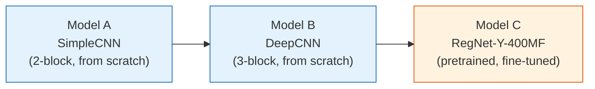

# Phase 2 Plan: Deep Learning — CNN + Beyond

> [!IMPORTANT]
> **Teacher's requirement:** "Train a two or three block CNN with pooling, dropout and early stopping."
> **Expected deliverable:** "A classifier notebook with AML versus CNN confusion examples and a concise error analysis."

---

## 1. What We're Building (3 Models, Increasing Complexity)



| Model | What It Is | Why Include It | Complexity |
|:------|:-----------|:---------------|:-----------|
| **Model A: SimpleCNN** | 2 Conv blocks → FC → Softmax | Teacher's core requirement. Direct comparison to Phase 1. | Low |
| **Model B: DeepCNN** | 3 Conv blocks → FC → Softmax | Shows ablation (does a 3rd block help?). Still "from scratch". | Low |
| **Model C: RegNet-Y-400MF** | Pretrained ImageNet backbone, fine-tuned | "Hybrid Innovation" deliverable. Shows transfer learning. Small, modern, efficient (unlike AlexNet which is old/huge). | Medium |

> [!TIP]
> **Why RegNet over AlexNet?**
> - AlexNet (2012) is 61M parameters, designed for 224×224 RGB — massively overkill for 28×28 grayscale and considered outdated.
> - RegNet-Y-400MF (2020) is only ~4M parameters, has a modern design (grouped convolutions, SE blocks), and is available in `torchvision.models`. It shows you know current literature without adding complexity.
> - Alternative: **MobileNetV3-Small** (~2.5M params) is equally valid and even lighter. Pick whichever you prefer.

---

## 2. Architecture Details

### Model A: SimpleCNN (2-Block)

```
Input: (1, 28, 28)                         ← grayscale, channel-first for PyTorch

Block 1:
  Conv2d(1 → 32, kernel=3, padding=1)      ← 32 filters, same padding
  BatchNorm2d(32)
  ReLU
  MaxPool2d(2)                              ← 28×28 → 14×14
  Dropout2d(0.25)

Block 2:
  Conv2d(32 → 64, kernel=3, padding=1)
  BatchNorm2d(64)
  ReLU
  MaxPool2d(2)                              ← 14×14 → 7×7
  Dropout2d(0.25)

Classifier Head:
  Flatten()                                 ← 64 × 7 × 7 = 3,136
  Linear(3136 → 128)
  ReLU
  Dropout(0.5)
  Linear(128 → 10)
```

**Total params:** ~410K (tiny — trains in minutes on CPU, seconds on GPU)

### Model B: DeepCNN (3-Block)

Same as Model A, plus:
```
Block 3:
  Conv2d(64 → 128, kernel=3, padding=1)
  BatchNorm2d(128)
  ReLU
  MaxPool2d(2)                              ← 7×7 → 3×3
  Dropout2d(0.25)

Classifier Head:
  Flatten()                                 ← 128 × 3 × 3 = 1,152
  Linear(1152 → 256)
  ReLU
  Dropout(0.5)
  Linear(256 → 10)
```

**Total params:** ~440K

### Model C: RegNet-Y-400MF (Fine-Tuned)

```
Pretrained RegNet-Y-400MF (torchvision)
  - Modify stem conv: Conv2d(1, ...) instead of Conv2d(3, ...)  ← grayscale input
  - Replace final FC: Linear(440 → 10)                         ← 10 classes
  - Freeze backbone for 5 epochs, then unfreeze all for 10 more
  - Use smaller learning rate (1e-4) for backbone, higher (1e-3) for new head
```

---

## 3. Training Setup (Shared Across All CNN Models)

| Setting | Value | Rationale |
|:--------|:------|:----------|
| **Framework** | PyTorch (+ torchvision for RegNet) | Industry standard, cleaner than TF for research |
| **Optimizer** | Adam (lr=1e-3 for A/B, differential lr for C) | Fast convergence, standard choice |
| **Loss** | CrossEntropyLoss | Multi-class classification standard |
| **Batch size** | 128 | Fits in CPU RAM, good gradient estimate |
| **Epochs** | 30 max | With early stopping, usually converges by 15-20 |
| **Early stopping** | Patience=5 on val macro F1 | Teacher explicitly requires this |
| **LR scheduler** | ReduceLROnPlateau (factor=0.5, patience=3) | Simple, effective |
| **Data augmentation** | Random horizontal flip + random rotation(±10°) | Minimal, keeps it simple. Shirts don't flip vertically. |
| **Data splits** | Same seed=42 48k/12k/10k from Phase 1 | Apples-to-apples comparison |
| **Evaluation** | Same `compute_metrics()` from `src/aml/evaluation.py` | Reuse Phase 1 infrastructure |

---

## 4. Deliverables Mapping

Here's how each required deliverable maps to concrete work:

### 4.1 Architecture Logic ✅
- **What to do:** In the notebook + report, explain *why* you chose 2-block → 3-block → RegNet progression. Diagram the receptive field growth. Show parameter counts.
- **Key argument:** "Phase 1 proved the bottleneck is feature representation, not classifier power. CNNs learn hierarchical spatial features that resolve upper-body confusion."

### 4.2 Hybrid Innovation ✅
- **What to do:** The RegNet fine-tuning IS the hybrid innovation — combining pretrained ImageNet representations with our domain-specific Fashion-MNIST task.
- **Also mention:** You could frame the entire project as hybrid: "Phase 1 handcrafted features (HOG) + Phase 2 learned features (CNN) = hybrid feature pipeline comparison."

### 4.3 Ablation Studies ✅
- **What to do:** A simple ablation table in the notebook. Toggle ONE thing at a time from Model B (the 3-block CNN):

| Ablation | What You Remove/Change | Expected Effect |
|:---------|:----------------------|:----------------|
| No Dropout | Remove all Dropout layers | Overfitting ↑, val accuracy ↓ |
| No BatchNorm | Remove BatchNorm layers | Training slower/unstable |
| No Augmentation | Remove random flip/rotation | Slight overfit on training data |
| 2 Blocks vs 3 Blocks | Model A vs Model B | Quantify the 3rd block's value |
| No Early Stopping | Train full 30 epochs | Show when overfitting kicks in |

That's **5 ablation runs** — simple, clean, tells a story.

### 4.4 Deep Learning Literature Review ✅
- **What to do:** A short section (1-2 pages) in the LaTeX report citing 5-8 papers. Keep it targeted:
  1. **LeCun et al. (1998)** — LeNet-5, the OG CNN on MNIST
  2. **Krizhevsky et al. (2012)** — AlexNet, breakthrough on ImageNet (mention but explain why we don't use it)
  3. **He et al. (2016)** — ResNets, skip connections concept
  4. **Radosavovic et al. (2020)** — RegNets, design space for efficient networks
  5. **Srivastava et al. (2014)** — Dropout as regularization
  6. **Ioffe & Szegedy (2015)** — Batch Normalization
  7. **Xiao et al. (2017)** — Fashion-MNIST paper itself
  8. *(Optional)* **Howard et al. (2019)** — MobileNetV3 if you use it instead of RegNet

### 4.5 DL Dataset & Regularization ✅
- **What to do:** Document in notebook + report:
  - Same Fashion-MNIST, same splits (seed=42), same normalization
  - Regularization techniques used: **Dropout** (0.25 conv, 0.5 FC), **BatchNorm**, **Early Stopping**, **Data Augmentation**, **Weight Decay** (1e-4 in Adam)
  - Training curves showing train vs. val loss/accuracy per epoch

### 4.6 Technical Validation ✅
- **What to do:** The main notebook output:
  - Confusion matrices for all 3 CNN models (side-by-side with Phase 1 best = RF Pixels)
  - **AML vs CNN confusion examples** (teacher's explicit requirement): Show specific test images where RF failed but CNN succeeds, especially Shirts
  - Per-class recall comparison bar chart (Phase 1 models + Phase 2 models)
  - Statistical: McNemar's test or simple paired proportion test (CNN vs RF on the same 10k test images)

### 4.7 Theoretical Rigor ✅
- **What to do:** In report, explain:
  - Receptive field calculation for each block
  - Why convolution preserves spatial locality (vs. flattening destroying it)
  - Translation equivariance of conv layers
  - Universal approximation perspective: why deeper = more expressive

### 4.8 GitHub Repository & Code Quality ✅
- **What to do:** Clean module structure (see Section 5 below), docstrings, type hints, unit tests for the CNN module

### 4.9 Project Presentation ✅
- **What to do:** Update the Phase 1 PPT or create Phase 2 slides (4-6 new slides):
  1. Phase 2 motivation (recap "The Gap")
  2. CNN architecture diagram
  3. Training curves
  4. Results comparison (AML vs CNN)
  5. Ablation findings
  6. Conclusion + RegNet transfer learning results

### 4.10 Viva Voce ✅
- **Prepare for:** See Section 8 below (expected questions)

### 4.11 Project Report (LaTeX/IEEE format) ✅
- **What to do:** 8-12 page IEEE two-column paper covering both phases. Structure in Section 7 below.

---

## 5. File Structure for Phase 2

New files to create (keeping Phase 1 intact):

```
Image-Tagging/
├── requirements.txt                    ← ADD: torch, torchvision, torchinfo
├── README.md                           ← Main repo guide (will be updated at end to cover Phase 1 + 2)
├── phase2_plan.md                      ← Phase 2 master plan
├── phase2_team_guide.md                ← Team execution & file ownership guide
│
├── src/
│   ├── aml/                            ← Phase 1: Applied ML (Untouched)
│   │   ├── data.py
│   │   ├── evaluation.py
│   │   ├── features.py
│   │   └── models/ (logreg, knn, rf, svm)
│   │
│   └── dl/                             ← Phase 2: Deep Learning Package
│       ├── __init__.py
│       ├── data.py                     ← NEW: PyTorch Dataset, DataLoaders, transforms
│       ├── training.py                 ← NEW: train loop, evaluation, early stopping, LR scheduler
│       └── models/
│           ├── __init__.py
│           ├── cnn.py                  ← NEW: SimpleCNN, DeepCNN classes
│           └── regnet.py               ← NEW: RegNet fine-tuning wrapper
│
├── notebooks/
│   ├── 07_cnn_experiments.ipynb        ← NEW: Main Phase 2 notebook (THE deliverable)
│   ├── 08_ablation_study.ipynb         ← NEW: Ablation runs and comparison
│   └── 09_regnet_transfer_learning.ipynb ← NEW: Pretrained RegNet fine-tuning
│
├── tests/
│   └── test_cnn.py                     ← NEW: Unit tests for CNN forward pass, shapes
│
└── phase2_reports/                     ← NEW: All Phase 2 deliverables centralized in one place
    ├── results/
    │   ├── cnn_simple.json             ← NEW: SimpleCNN results (same JSON schema)
    │   ├── cnn_deep.json               ← NEW: DeepCNN results
    │   ├── regnet_finetuned.json       ← NEW: RegNet results
    │   └── ablation_study.json         ← NEW: 5-variable ablation results
    ├── figures/                        ← NEW: training curves, confusion matrices, shirt recovery gallery
    ├── latex_report/                   ← NEW: IEEE LaTeX format report (no confusion with Phase 1 reports/)
    │   ├── main.tex
    │   └── references.bib
    ├── phase2_presentation.pptx        ← NEW: Phase 2 slides
    └── phase2_error_analysis.md        ← NEW: AML vs CNN error comparison
```

---

## 6. Team Work Division for Phase 2

Each team member owns distinct, non-overlapping modules and notebooks to prevent merge conflicts:

| Member | Phase 2 Ownership | Files |
|:-------|:-------------------|:------|
| **Anant Jain** | PyTorch Dataset & data loader pipeline (`data.py`), master direct push coordination | `src/dl/data.py` |
| **Kartik Mehra** | Training loop, optimization & early stopping engine (`training.py`) | `src/dl/training.py` |
| **Vipul Sharma** | Core CNN model architectures (`cnn.py`), unit testing (`test_cnn.py`), 5-variable ablation study (`08_ablation_study.ipynb`), and Phase 2 presentation deck (`phase2_presentation.pptx`) | `src/dl/models/cnn.py`, `tests/test_cnn.py`, `notebooks/08_ablation_study.ipynb`, `phase2_reports/results/ablation_study.json`, `phase2_reports/phase2_presentation.pptx` |
| **Krishna Gehlot** | CNN training benchmark notebook (07), training curves, confusion matrices | `notebooks/07_cnn_experiments.ipynb`, `phase2_reports/results/cnn_*.json` |
| **Aditya** | RegNet-Y-400MF transfer learning model + training, fine-tuning results | `src/dl/models/regnet.py`, `notebooks/09_regnet_transfer_learning.ipynb`, `phase2_reports/results/regnet_finetuned.json` |
| **Utkarsh Jain** | Phase 2 error analysis (AML vs CNN examples, Shirt recovery gallery), IEEE LaTeX report draft | `phase2_reports/phase2_error_analysis.md`, `phase2_reports/latex_report/main.tex` |

> [!NOTE]
> This division keeps the same parallel pattern as Phase 1. Everyone can work on their own files without merge conflicts.

---

## 7. LaTeX Report Structure (IEEE Format)

```
1. Abstract (200 words)
2. Introduction
   - Problem: clothing classification for inventory tagging
   - Motivation: why both AML and DL approaches
3. Related Work (Literature Review — 1.5 pages)
   - Fashion-MNIST benchmarks
   - Classical ML on image classification
   - CNN architectures (LeNet → AlexNet → RegNet evolution)
   - Regularization techniques (Dropout, BatchNorm)
4. Dataset & Experimental Setup
   - Fashion-MNIST description, splits, preprocessing
   - Evaluation protocol (accuracy, macro F1, per-class recall, latency)
5. Phase 1: AML Baseline
   - Feature representations (Pixels, HOG)
   - Models (LogReg, k-NN, RF, SVM)
   - Results table (8 configurations)
   - "The Gap" — upper-body confusion analysis
6. Phase 2: Deep Learning
   - CNN architectures (SimpleCNN, DeepCNN)
   - Training procedure (optimizer, early stopping, augmentation)
   - Transfer learning (RegNet fine-tuning)
   - Ablation study results
7. Results & Comparative Analysis
   - AML vs CNN results table (all 11 configurations)
   - Confusion matrix comparison (RF vs DeepCNN vs RegNet)
   - AML vs CNN error examples (the gallery)
   - Shirt recall improvement analysis
8. Discussion
   - Why CNN succeeds where AML fails
   - Cost-accuracy tradeoff (latency, model size)
   - Limitations and future work
9. Conclusion
10. References (8-12 papers)
```

**Target length:** 8-10 pages (IEEE two-column). Not too long.

---

## 8. Expected Viva Questions & Answers

### CNN Fundamentals
1. **Q: Why does a CNN work better than flattened pixels + LogReg?**
   > "CNNs preserve 2D spatial topology through local receptive fields. A 3×3 filter detects edges, collars, and seams as spatial patterns rather than independent pixel values. Weight sharing makes these detectors translation-equivariant — a collar is recognized regardless of position."

2. **Q: What does each conv block learn?**
   > "Block 1 learns low-level edges and textures (horizontal, vertical, diagonal). Block 2 combines edges into mid-level features (collar shapes, sleeve boundaries). Block 3 (if present) learns high-level garment-specific patterns (button plackets vs. crewnecks)."

3. **Q: Why use MaxPool instead of AveragePool?**
   > "MaxPool retains the strongest activation (the most prominent edge/feature) in each region, making the network more robust to small spatial shifts. AveragePool would dilute strong signals with background noise."

### Regularization
4. **Q: Explain your dropout strategy (0.25 conv, 0.5 FC).**
   > "Conv layers have fewer parameters per filter due to weight sharing, so they need less regularization (0.25). The fully-connected layers have thousands of parameters and are more prone to overfitting, so we use 0.5 dropout (randomly zeroing 50% of neurons during training)."

5. **Q: How does early stopping work?**
   > "We monitor validation macro F1 after each epoch. If it doesn't improve for 5 consecutive epochs (patience=5), we stop training and restore the model weights from the best epoch. This prevents the model from memorizing training noise."

6. **Q: What is BatchNorm and why use it?**
   > "BatchNorm normalizes each layer's activations to zero mean and unit variance within each mini-batch. This stabilizes training, allows higher learning rates, and acts as a mild regularizer."

### Transfer Learning
7. **Q: Why fine-tune RegNet instead of training from scratch?**
   > "RegNet pretrained on ImageNet has already learned general visual features (edges, textures, shapes) from 1.2 million natural images. Even though Fashion-MNIST is grayscale 28×28, the low-level filters transfer well. Fine-tuning adapts these features to our specific 10-class clothing task with less data and fewer epochs."

8. **Q: How did you handle the grayscale → RGB mismatch?**
   > "RegNet expects 3-channel RGB input. We modified the first convolutional layer to accept 1 channel instead of 3, initializing it by averaging the pretrained 3-channel weights into a single channel."

### Comparison
9. **Q: What was the biggest improvement from Phase 1 to Phase 2?**
   > "Shirt recall. It was stuck at 50.7%–62.6% across all 8 AML configurations. The CNN should push it above 80% because learned convolutional filters can detect the subtle collar and button features that HOG's 7×7 cell pooling destroys."

10. **Q: Is the CNN always better? Any tradeoff?**
    > "The CNN is more accurate but has higher latency (~0.5–2 ms vs. 0.0004 ms for LogReg HOG) and requires GPU for fast training. For a high-throughput production system processing millions of images, the deployment cost is higher. LogReg on HOG remains the fastest option when speed matters more than accuracy."

---

## 9. Timeline (Suggested)

| Week | Task | Who |
|:-----|:-----|:----|
| **Week 1** | Set up PyTorch, data loaders, training loop, SimpleCNN + DeepCNN model files | Anant, Kartik |
| **Week 1** | Literature review draft | Utkarsh |
| **Week 2** | Train SimpleCNN + DeepCNN, generate training curves and confusion matrices | Krishna, Vipul |
| **Week 2** | RegNet fine-tuning implementation and training | Aditya |
| **Week 2** | Run 5 ablation experiments | Vipul |
| **Week 3** | Phase 2 error analysis (AML vs CNN examples), compile results | Utkarsh |
| **Week 3** | LaTeX report writing (all contribute their sections) | Everyone |
| **Week 3** | Phase 2 presentation slides | Anant |
| **Week 4** | Final polish, viva preparation, push everything to GitHub | Everyone |

---

## 10. Success Criteria (from Phase 1 error_analysis.md)

These are the targets we already defined:

| Metric | Phase 1 Best | Phase 2 Target |
|:-------|:-------------|:---------------|
| **Shirt Recall** | 62.6% (k-NN HOG) | ≥ 80.0% |
| **Upper-Body Shirt Confusion** | 32.3%–41.0% | < 15.0% |
| **Overall Macro F1** | 87.31% (RF Pixels) | ≥ 91.0% |

> [!CAUTION]
> These targets are ambitious but realistic for a 3-block CNN on Fashion-MNIST. Published benchmarks show simple CNNs reaching 91-93% accuracy on this dataset.

---

## 11. Key Dependencies to Add

```
# Add to requirements.txt
torch>=2.0.0
torchvision>=0.15.0
torchinfo>=1.8.0        # For model.summary() style output
```

No GPU required — Fashion-MNIST is small enough that CPU training takes ~5-10 minutes for 30 epochs. If anyone has a GPU, great, but it's not blocking.
