# Garment Error Analysis: The Gap Left by Handcrafted Features

## Executive Summary & Scope

Phase 1 establishes a rigorous Applied Machine Learning (AML) benchmark on Fashion-MNIST across four distinct model families:
1. **Linear Support Vector Machine (Linear SVM)**
2. **Multinomial Logistic Regression**
3. **Random Forest (Ensemble Trees)**
4. **$k$-Nearest Neighbors ($k$-NN)**

Each model is evaluated on two distinct feature representations: **Flattened Pixels (784 dimensions)** and **Histogram of Oriented Gradients (HOG, 324 dimensions)**, yielding eight standardized experimental records in [`reports/results/`](file:///Users/vipulsharma/Desktop/Image-Tagging/reports/results).

While aggregate test accuracy reaches between **83.8% and 87.4%**, aggregate metrics mask a catastrophic, universal bottleneck: **Shirt (Class 6)** consistently exhibits a ~35-percentage-point recall deficit compared to structured categories like Trousers, Sneakers, and Bags. 

This report synthesizes empirical evidence across exploratory data analysis ([`notebooks/01_exploratory_data_analysis.ipynb`](file:///Users/vipulsharma/Desktop/Image-Tagging/notebooks/01_exploratory_data_analysis.ipynb)), feature exploration ([`notebooks/02_feature_exploration.ipynb`](file:///Users/vipulsharma/Desktop/Image-Tagging/notebooks/02_feature_exploration.ipynb)), model-specific experiments ([`notebooks/03`](file:///Users/vipulsharma/Desktop/Image-Tagging/notebooks/03_logistic_regression.ipynb) through [`06`](file:///Users/vipulsharma/Desktop/Image-Tagging/notebooks/06_svm_and_error_analysis.ipynb)), and cross-model comparison ([`notebooks/00_master_aml_comparison.ipynb`](file:///Users/vipulsharma/Desktop/Image-Tagging/notebooks/00_master_aml_comparison.ipynb)). Rather than treating accuracy as an explanation, we audit the geometric and perceptual reasons why handcrafted features fail, establishing the necessity for learned hierarchical spatial representations in Phase 2.

---

## 1. Cross-Model Upper-Body Comparison: The Universal Bottleneck

Across all eight model-feature configurations, model performance bifurcates dramatically between unambiguous silhouette classes and upper-body garments.

### Comprehensive Benchmark Performance

| Model | Representation | Test Accuracy | Macro F1 | T-shirt (0) | Pullover (2) | Coat (4) | **Shirt (6)** | Trouser (1) | Sneaker (7) | Bag (8) | Ankle Boot (9) |
|---|---|---|---|---|---|---|---|---|---|---|---|
| **Linear SVM** | Pixels (784) | 83.80% | 83.57% | 81.9% | 72.8% | 77.7% | **50.7%** | 95.4% | 93.4% | 94.0% | 94.1% |
| **Linear SVM** | HOG (324) | 84.23% | 84.06% | 80.0% | 73.4% | 73.8% | **54.6%** | 94.8% | 93.9% | 97.1% | 95.7% |
| **Logistic Regression** | Pixels (784) | 84.32% | 84.24% | 80.6% | 73.7% | 76.0% | **57.1%** | 95.8% | 93.8% | 93.2% | 94.8% |
| **Logistic Regression** | HOG (324) | 84.55% | 84.49% | 80.6% | 73.0% | 75.5% | **57.8%** | 94.8% | 92.7% | 97.2% | 95.4% |
| **Random Forest** | Pixels (784) | **87.43%** | **87.31%** | 85.9% | 78.9% | 81.1% | **59.3%** | 96.1% | 95.2% | 97.3% | 94.6% |
| **Random Forest** | HOG (324) | 84.35% | 84.30% | 81.2% | 73.6% | 74.7% | **59.4%** | 92.6% | 90.8% | 96.9% | 93.9% |
| **$k$-NN** | Pixels (784) | 85.41% | 85.40% | 84.8% | 80.3% | 77.0% | **60.2%** | 96.7% | 95.6% | 95.3% | 95.9% |
| **$k$-NN** | HOG (324) | 83.84% | 83.85% | 80.2% | 71.7% | 74.0% | **62.6%** | 95.7% | 95.3% | 96.6% | 94.7% |

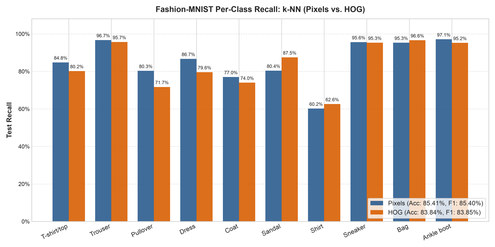
*Figure 1: Per-class test recall comparison across models demonstrating the consistent drop for Shirt (Class 6).*

### Key Empirical Findings

1. **The 35-Percentage-Point Recall Chasm:**  
   In all configurations, **Shirt recall languishes between 50.7% and 62.6%**. In stark contrast, structural classes like Trousers (92.6%–96.7%), Bags (93.2%–97.3%), and Footwear (90.8%–97.1%) reliably achieve high-90s accuracy regardless of classifier choice.
2. **HOG Does Not Resolve Fine-Grained Ambiguity:**  
   Moving from raw pixels to HOG descriptors compresses features by 58.7% and improves Bag classification (+3.1% to +4.0%), but delivers negligible benefit for Shirts (+3.9% for SVM, +0.7% for LogReg, +0.1% for RF, +2.4% for $k$-NN). Fixed gradient orientation bins fail to capture the subtle discriminator features needed for upper-body separation.
3. **Model Complexity Cannot Overcome Feature Limitations:**  
   Neither non-linear axis-aligned partitioning (Random Forest with 100–200 trees) nor non-parametric local metric neighborhoods ($k$-NN) can break past ~62% recall on Shirts. The upper-body bottleneck is fundamentally an **input representation problem**, not an inductive bias deficiency of any single algorithm.

---

## 2. Directional Confusion and The Upper-Body Confusion Cluster

Auditing the full $10 \times 10$ test confusion matrix highlights where misclassified garments actually go.

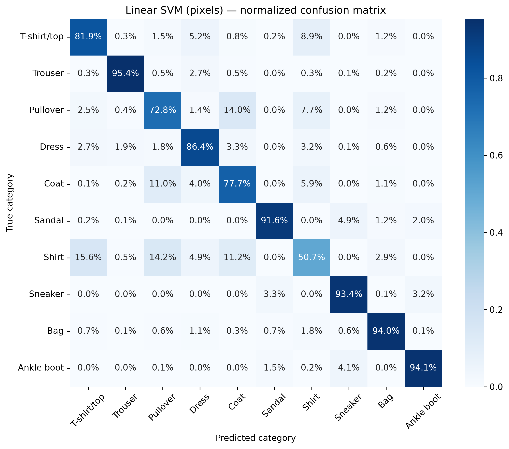
*Figure 2: Row-normalized 10-class confusion matrix for Linear SVM on raw pixels.*

### Quantitative Cross-Model Confusion Breakdown

When normalized against the full test set (so row percentages sum to 100% across all 10 true classes), the upper-body confusion is strikingly concentrated and directional:

| Model | Representation | True Shirt $\rightarrow$ T-shirt (0) | True Shirt $\rightarrow$ Pullover (2) | True Shirt $\rightarrow$ Coat (4) | **Total Upper-Body Shirt Confusion** | True Pullover $\rightarrow$ Coat (4) |
|---|---|---|---|---|---|---|
| **Linear SVM** | Pixels | 15.6% | 14.2% | 11.2% | **41.0%** | 14.0% |
| **Linear SVM** | HOG | 16.5% | 10.8% | 10.6% | **37.9%** | 14.2% |
| **Logistic Regression** | Pixels | 13.8% | 12.0% | 10.4% | **36.2%** | 12.5% |
| **Logistic Regression** | HOG | 15.1% | 10.0% | 11.4% | **36.5%** | 13.4% |
| **Random Forest** | Pixels | 14.8% | 12.0% | 9.0% | **35.8%** | 13.0% |
| **Random Forest** | HOG | 14.9% | 8.8% | 10.2% | **33.9%** | 13.9% |
| **$k$-NN** | Pixels | 16.6% | 12.2% | 7.5% | **36.3%** | 8.4% |
| **$k$-NN** | HOG | 13.1% | 8.2% | 11.0% | **32.3%** | 16.8% |

Across all models, **between 32.3% and 41.0% of all test Shirts are misclassified specifically as T-shirts, Pullovers, or Coats**. Virtually no shirts are confused with Trousers or Footwear (<0.3%).

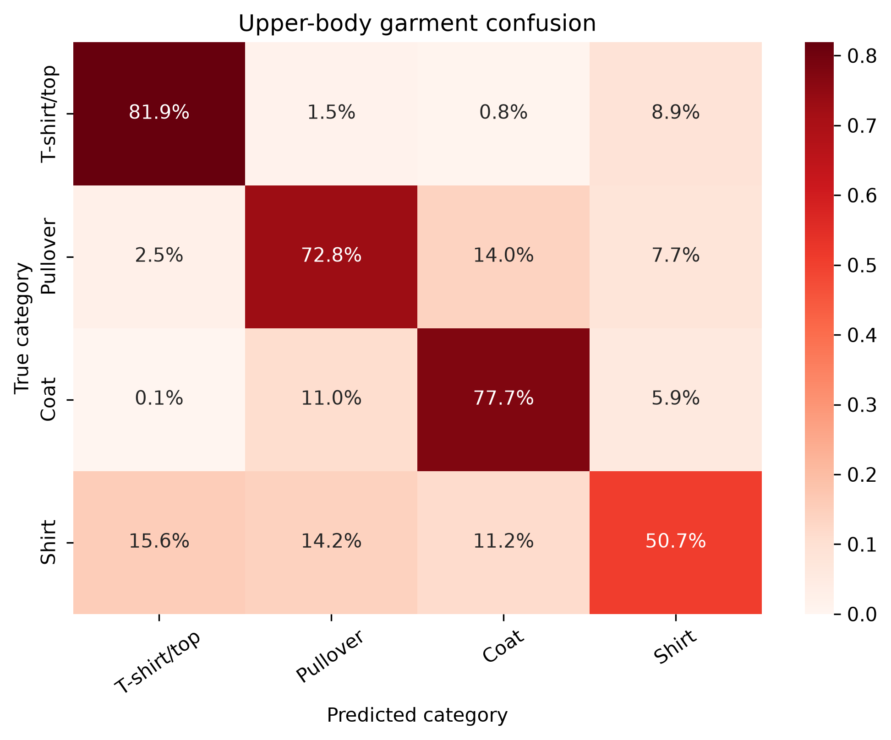
*Figure 3: Focused upper-body confusion submatrix (classes 0, 2, 4, 6) with full-row normalization.*

### Qualitative Error Analysis: Test-Set Error Galleries

Inspecting actual misclassified test images confirms why these errors occur:

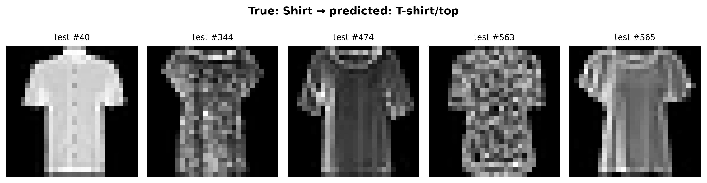
*Figure 4: Test-set Shirts misclassified as T-shirt/top by Linear SVM on Pixels.*

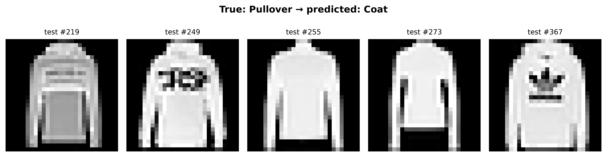
*Figure 5: Test-set Pullovers misclassified as Coat by Linear SVM on Pixels.*

- **True Shirt $\rightarrow$ Predicted T-shirt/top:**  
  Casual collared shirts, short-sleeve polo shirts, and lightweight blouses lack visible collar elevation at $28 \times 28$ grayscale resolution. Without color or depth cues, their silhouette collapses into the crewneck torso archetype.
- **True Shirt $\rightarrow$ Predicted Pullover / Coat:**  
  Long-sleeve button-down shirts with heavier fabric or dark plackets present identical sleeve contours and torso mass to pullovers and coats.
- **True Pullover $\rightarrow$ Predicted Coat:**  
  Cardigans, zippered knitwear, and open sweaters closely mimic outerwear silhouettes.

At $28 \times 28$ resolution, diagnostic features such as collar tips, buttons, plackets, and lapels span only 1 to 2 pixels. When encoded via handcrafted methods, these critical cues are drowned out by dominant torso mass.

---

## 3. Why the Phase 1 Representations Plateau

### 3.1 Flattened Pixels: Spatial Oblivion and Coordinate Rigidity

Flattening a $28 \times 28$ image produces a 784-dimensional vector where spatial adjacency is discarded:

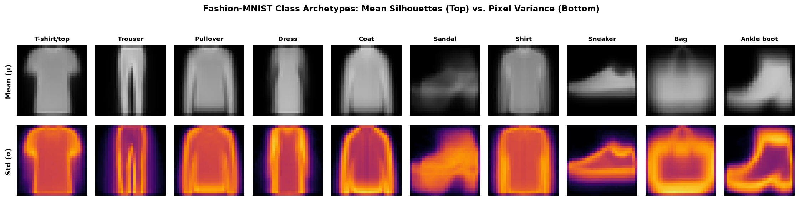
*Figure 6: Mean intensity and pixel-wise variance across categories from exploratory data analysis.*

1. **Torso Silhouette Overlap:**  
   As shown in the EDA archetype analysis, T-shirt, Pullover, Coat, and Shirt share nearly indistinguishable mean silhouettes. High variance is confined to necklines and sleeve hems.
2. **Topological Overlap in Feature Space:**  
   Unsupervised 2D PCA projection reveals that while Trousers and Footwear form isolated clusters, upper-body tops merge into a single dense, entangled continuum.
3. **Lack of Translation Invariance:**  
   In flattened pixel space, shifting a collar 2 pixels to the right alters coordinate values across multiple dimensions. A linear or distance-based model cannot generalize that the feature is identical in meaning.

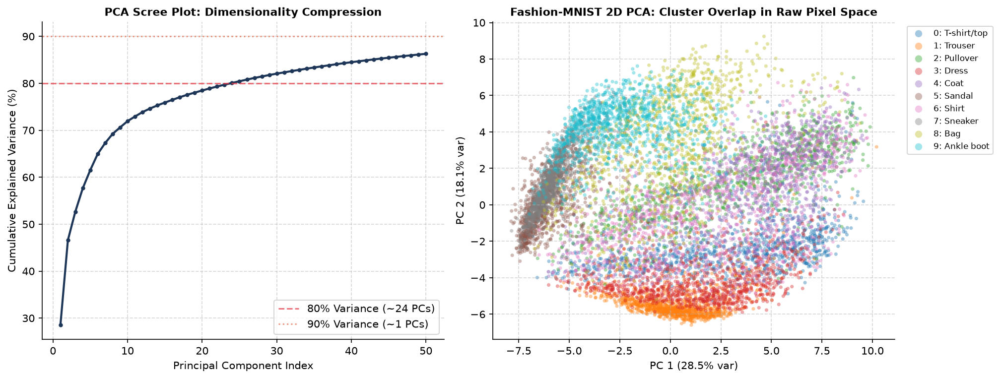
*Figure 7: 2D PCA projection showing severe topological overlap among upper-body categories (0, 2, 4, 6).*

### 3.2 HOG Descriptors: Pre-Defined Vocabulary and Destructive Spatial Pooling

HOG was designed to capture local shape contours via gradient orientation histograms. While effective for rigid structures, it falls short on fine garment distinctions:

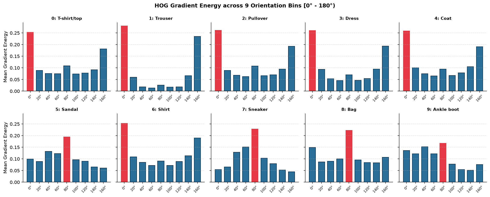
*Figure 8: Polar orientation profiles highlighting sharp directional peaks in Trousers and Footwear vs. isotropic diffuse energy in Tops.*

1. **Isotropic Orientation Energy:**  
   Unlike Trousers (strong vertical peaks at 90°) or Footwear (horizontal edges at 0°/180°), upper-body garments feature diffuse gradient distributions in all directions.
2. **Destructive Spatial Pooling:**  
   AML HOG uses $7 \times 7$ pixel cells with $2 \times 2$ cell blocks. Within a $7 \times 7$ cell, gradients from buttons, seams, and collar points are pooled into orientation bins alongside surrounding fabric. This averaging destroys the micro-texture cues required to tell a polo shirt from a crewneck.

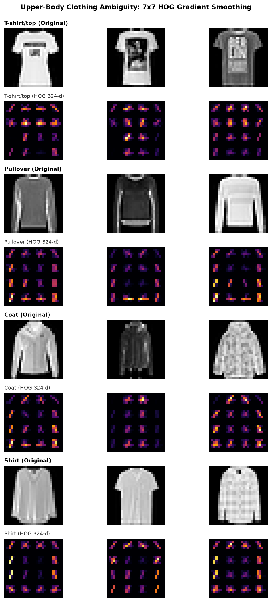
*Figure 9: Visual comparison of original $28 \times 28$ upper-body garments and their corresponding HOG gradient reconstructions.*

---

## 4. Decision Boundary Mechanics Across Model Families

Each AML model family encounters fundamental limitations when operating on these handcrafted features:

### Linear Classifiers (Linear SVM & Logistic Regression)
- **Mechanism:** Learn hyperplanes $w^T x + b = 0$ in $\mathbb{R}^{784}$ or $\mathbb{R}^{324}$.
- **Diagnostic Evidence:** Weight heatmaps show that linear models assign broad negative weights to the neckline and collar zones to separate Shirts from T-shirts. However, because individual pixel intensities vary wildly with garment color and pattern, fixed linear weights cannot isolate collar structure.
- **Tuning Limit:** Sweeping regularization $C \in \{0.1, 1.0, 10.0\}$ shifts the margin penalty but cannot separate distributions that overlap in the underlying coordinate space.

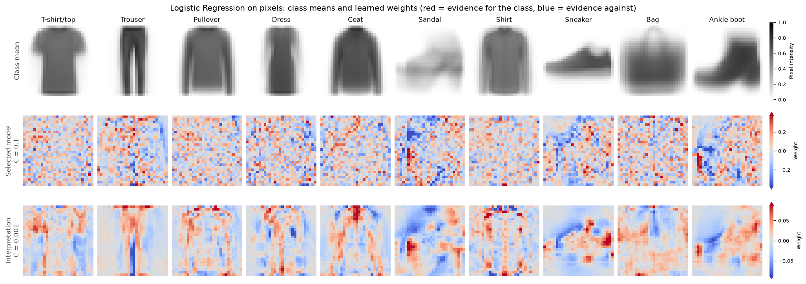
*Figure 10: Multinomial Logistic Regression weight heatmaps per category in pixel space.*

### Decision Tree Ensembles (Random Forest)
- **Mechanism:** Recursively partition feature space using orthogonal, axis-aligned splits ($x_j \le \theta$).
- **Diagnostic Evidence:** Pixel importance heatmaps indicate that Random Forest focuses heavily on the outer silhouette boundaries and shoulder slopes.
- **Limitation:** Trees can model non-linear interactions (e.g., pixel A is bright AND pixel B is dark), but axis-aligned splits cannot rotate coordinates to detect diagonal lapels, collars, or continuous seams. Fully grown trees memorize the training set (100% train accuracy) while test accuracy on Shirts flattens at 59.4%.

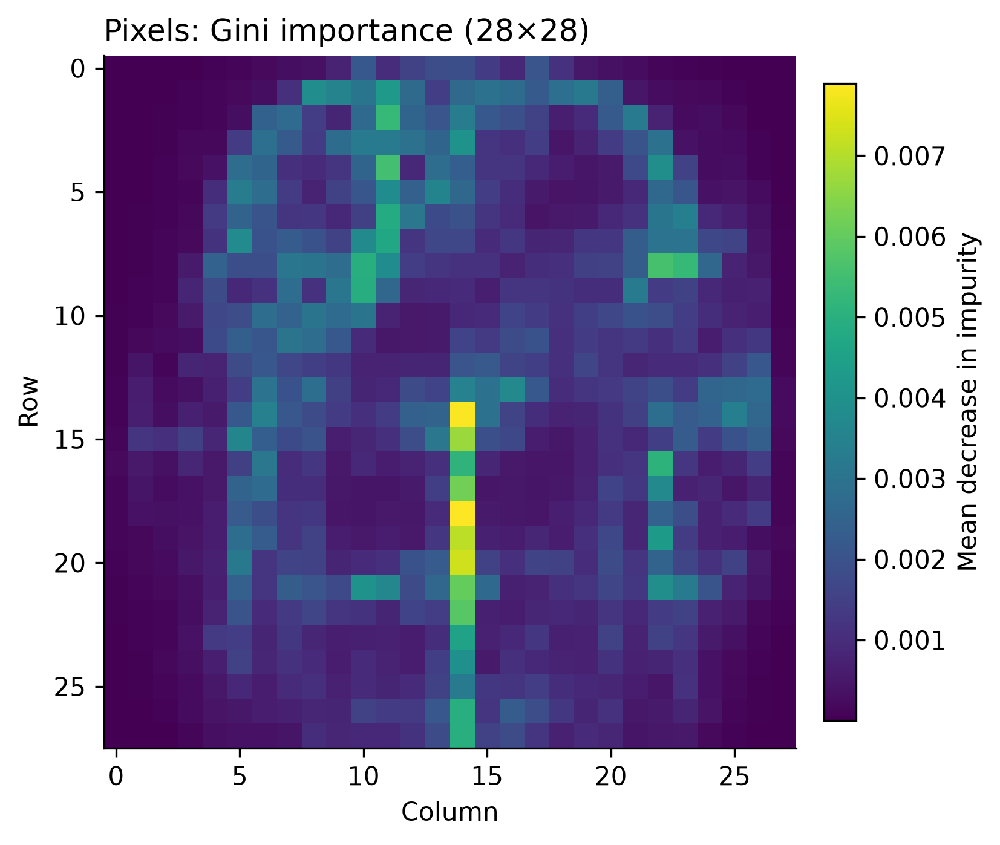
*Figure 11: Random Forest Gini feature importance mapped back to the $28 \times 28$ image grid.*

### Instance-Based Learners ($k$-NN)
- **Mechanism:** Assign labels by majority vote among the $k$ nearest Euclidean neighbors:
  $$d(x, z) = \sqrt{\sum_{i=1}^d (x_i - z_i)^2}$$
- **Curse of Dimensionality:** In 784-dimensional pixel space or 324-dimensional HOG space, distance concentration dilutes discriminative differences. The Euclidean distance between two garments is dominated by overall torso brightness and body width; subtle differences around the collar contribute negligible numerical distance.

---

## 5. Architectural Bridge to Phase 2: Small CNN

The empirical evidence from Phase 1 leads directly to the core hypothesis for Phase 2: **the performance ceiling on Fashion-MNIST is set by handcrafted feature representations, not by classifier optimization.**

A Convolutional Neural Network (CNN) directly addresses every failure mode documented in this report:

```
+-----------------------------------------------------------------------------------+
|                           PHASE 1 (AML Handcrafted Features)                       |
|   Image (28x28) ---> Flatten (784-d) / HOG (324-d) ---> Linear/Tree/KNN Classifier  |
|   * Spatial locality destroyed                                                   |
|   * Fixed, handcrafted gradient bins (7x7 cell pooling)                          |
|   * No translation tolerance                                                      |
|   * Result: Shirt Recall stuck at 50.7% - 62.6%                                   |
+-----------------------------------------------------------------------------------+
                                          |
                                          v  Phase 2 Architectural Shift
+-----------------------------------------------------------------------------------+
|                               PHASE 2 (Learned Small CNN)                         |
|   Image (28x28) ---> [Conv2D + ReLU + MaxPool] x 2 ---> Dense ---> Softmax        |
|   * Preserves 2D spatial topology                                                 |
|   * Adaptive, task-optimized visual filters (learned collars, plackets, lapels)   |
|   * Weight sharing & local receptive fields provide translation equivariance     |
|   * Result Target: Shirt Recall >= 80.0%, Macro F1 >= 91.0%                       |
+-----------------------------------------------------------------------------------+
```

### Inductive Biases of CNNs Addressing Phase 1 Deficiencies:
1. **Local Receptive Fields & Spatial Topology:**  
   $3 \times 3$ convolutional filters operate on local neighborhoods, preserving spatial relationships between adjacent pixels (seams, edges, buttons) that vector flattening destroys.
2. **Weight Sharing & Translation Equivariance:**  
   The same learned feature detector slides across the entire image. A collar or pocket is recognized regardless of slight spatial offsets or garment positioning on the $28 \times 28$ grid.
3. **Hierarchical Feature Abstraction:**  
   Early layers learn primitive oriented edges; intermediate layers combine edges into micro-textures and garment contours; deeper layers synthesize high-level diagnostic concepts (e.g., button plackets vs. continuous crewnecks).
4. **Adaptive End-to-End Optimization:**  
   Rather than fixing gradient orientation bins beforehand (as in HOG), the CNN optimizes filter parameters via backpropagation directly on cross-entropy loss, allocating representational capacity specifically to resolve ambiguous upper-body distinctions.

---

## 6. Auditable Success Criteria for Phase 2

To demonstrate that Phase 2 definitively closes the gap left by handcrafted features, the Small CNN must satisfy three auditable quantitative milestones on the exact same held-out 10,000-image test set:

1. **Shirt Recall Milestone:**  
   Elevate Shirt (Class 6) recall from the AML baseline range of **50.7%–62.6%** to **$\ge 80.0\%$** (an improvement of $\ge 17.4$ percentage points).
2. **Upper-Body Confusion Reduction:**  
   Reduce total upper-body Shirt misclassification (True Shirt $\rightarrow$ T-shirt / Pullover / Coat) from the current **32.3%–41.0%** range down to **$< 15.0\%$**.
3. **Overall Macro F1 Elevation:**  
   Elevate overall test Macro F1 from the AML ceiling of **84.5%** (LogReg HOG) / **87.3%** (RF Pixels) to **$\ge 91.0\%$** on the official test set.

By maintaining identical data splits (`data/raw/fashion_mnist_raw.npz`, seed 42) and evaluation metrics (`compute_metrics()`), Phase 2 will provide an unassailable, apples-to-apples demonstration of the power of learned representation over handcrafted feature engineering.
